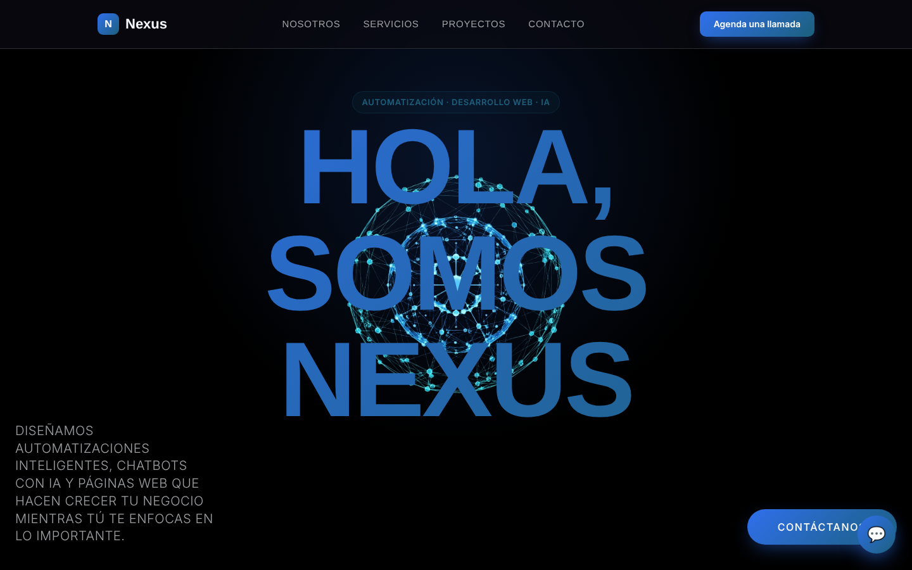
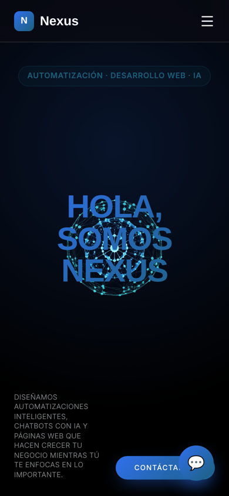

# Nexus — Landing page de agencia de automatización y desarrollo web

Sitio web de **Nexus**, una agencia enfocada en chatbots con IA, automatización de procesos con n8n y desarrollo de páginas web para pequeños y medianos negocios. Incluye un **chatbot integrado** que se conecta a un flujo de n8n y cuenta con respuestas locales de respaldo.

🔗 **Demo en vivo:** https://luisma-2601.github.io/nexus-agency/



<p align="center">
  
</p>

## Características

- **Chatbot conectable a n8n** — envía `{ message, sessionId }` a un webhook y muestra la respuesta del flujo. Si el webhook no está configurado o falla, responde con una base local de preguntas frecuentes, de modo que el chat nunca queda sin respuesta.
- **Respuestas rápidas** (quick replies) e indicador de "escribiendo…".
- **Animaciones de scroll** con Framer Motion y GSAP: texto animado, efecto magnético en botones, marquee de imágenes y tarjetas de proyectos apiladas (*sticky stack*).
- **Diseño 100 % responsive**, tipografía fluida con `clamp()` y tema oscuro.
- **Contenido separado del código**: textos, servicios, proyectos y canales de contacto viven en `src/data/`, por lo que el sitio se puede adaptar a otra marca sin tocar componentes.
- **Despliegue automático** a GitHub Pages con GitHub Actions en cada push a `main`.

## Stack

| Área | Tecnologías |
|---|---|
| Framework | React 19 · TypeScript |
| Build | Vite |
| Estilos | Tailwind CSS · PostCSS |
| Animación | Framer Motion · GSAP |
| Iconos | Lucide |
| Automatización | n8n (webhook) |
| Calidad | oxlint |
| CI/CD | GitHub Actions → GitHub Pages |

## Estructura

```
src/
├── components/
│   ├── chatbot/     # ChatWidget, lista de mensajes, input y respuestas rápidas
│   ├── common/      # Botones reutilizables
│   ├── layout/      # Header y Footer
│   ├── motion/      # FadeIn, Magnet, AnimatedText
│   └── sections/    # Hero, Marquee, Nosotros, Servicios, Proyectos, Contacto
├── data/            # Contenido editable: textos, proyectos, FAQ local, contacto
├── hooks/
│   └── useChatbot.ts  # Estado del chat + integración con n8n y respaldo local
└── types/
```

## Cómo correrlo localmente

Requisitos: Node.js 20 o superior.

```bash
git clone https://github.com/luisma-2601/nexus-agency.git
cd nexus-agency
npm install
cp .env.example .env   # opcional: configurar el webhook de n8n
npm run dev            # http://localhost:5173
```

Otros comandos:

```bash
npm run build     # build de producción en dist/
npm run preview   # sirve el build localmente
npm run lint      # análisis estático con oxlint
```

## Conectar el chatbot a n8n

1. Crear en n8n un flujo que empiece con un nodo **Webhook** (método `POST`).
2. El flujo recibe `{ "message": string, "sessionId": string }` y debe responder `{ "reply": string }`.
3. Colocar la URL del webhook en `.env`:

   ```env
   VITE_N8N_WEBHOOK_URL=https://tu-instancia-n8n.com/webhook/nexus-chatbot
   ```

Para el despliegue en GitHub Pages, la misma variable se define como *Repository variable* en **Settings → Secrets and variables → Actions → Variables**.

> La URL del webhook queda visible en el navegador, como cualquier endpoint público. Se recomienda validar y limitar las peticiones del lado de n8n.

## Despliegue

El workflow `.github/workflows/deploy.yml` compila el proyecto y lo publica en GitHub Pages en cada push a `main`. Para activarlo: **Settings → Pages → Source → GitHub Actions**.

Gracias a `base: './'` en `vite.config.ts`, el mismo build funciona en GitHub Pages, Vercel, Netlify o cualquier hosting estático.

## Nota sobre el contenido

Los proyectos que aparecen en la sección **Proyectos** (Clínica Vitalis, Tienda Andina, Estudio Lumen) son **casos demo** que ilustran el tipo de soluciones ofrecidas; no corresponden a clientes reales.

## Autor

**Luis Manuel Angulo Ramírez** — Estudiante de Ingeniería en Sistemas (Universidad Metropolitana, Caracas). Desarrollo de soluciones con IA, automatización y frontend.

- LinkedIn: [luis-angulo-ramirez](https://www.linkedin.com/in/luis-angulo-ramirez)
- GitHub: [@luisma-2601](https://github.com/luisma-2601)

## Licencia

Distribuido bajo licencia [MIT](LICENSE).
